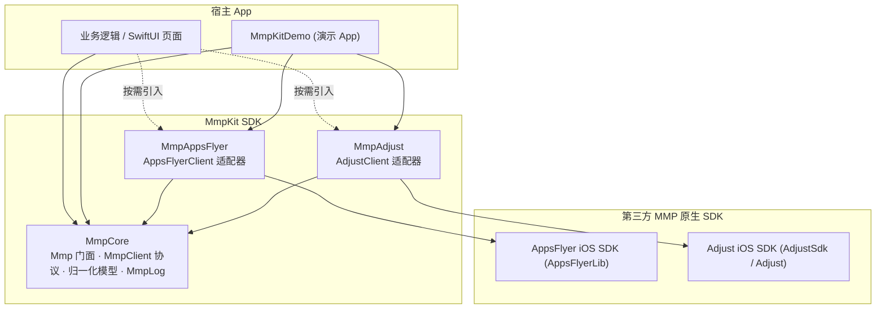
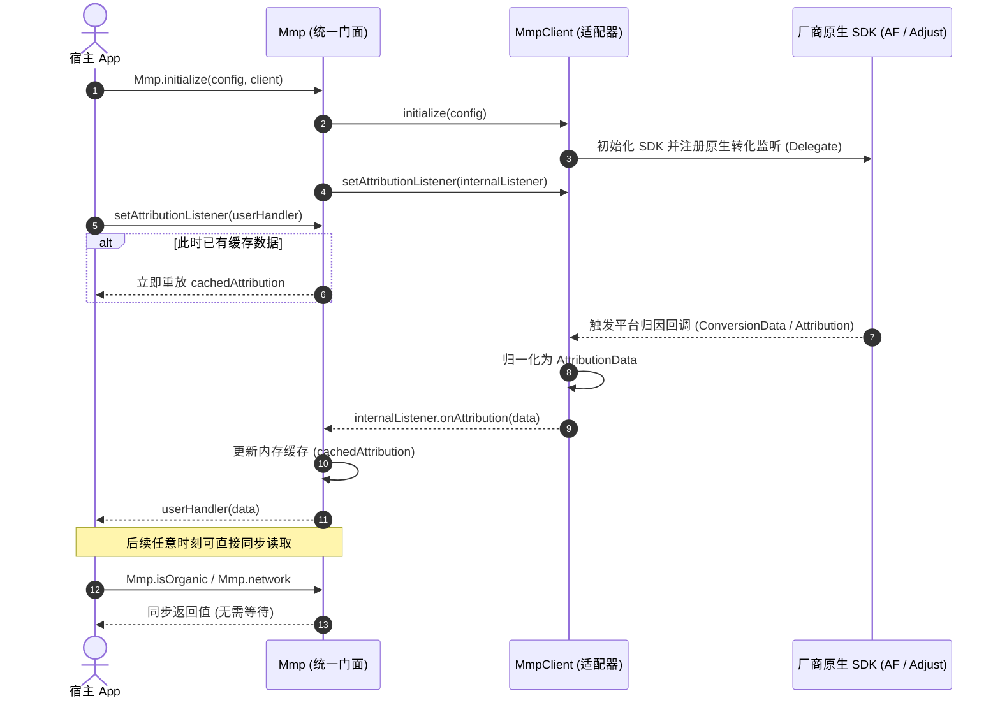

# MmpKit-iOS

[](#环境要求)
[](#环境要求)
[](#快速接入)
[](#快速接入)
[](LICENSE)

iOS 移动归因（Mobile Measurement Partner, MMP）统一封装架构（Swift 实现）。业务层只依赖单一门面 `Mmp`，通过在初始化时替换底层适配器（`AppsFlyerClient` / `AdjustClient` 等），实现零业务侵入、零调用侧改动的 MMP 平台平滑切换。

与 Android 端架构规范保持 100% 概念与数据模型对齐。

---

## 核心特性

- **统一 Swift 门面**：业务层完全与具体厂商 SDK 解耦，通过静态门面 `Mmp.*` 完成事件上报、收入统计与归因读取。
- **归一化数据模型**：各厂商异构字段自动映射为标准化 `AttributionData`（`network`, `campaign`, `adGroup`, `creative`, `clickLabel`, `isOrganic`, `raw`），全面适配 Swift 6 `@unchecked Sendable`。
- **同步缓存直读（Hot Cache）**：归因结果自动内存缓存，支持通过 `Mmp.isOrganic`、`Mmp.network` 等同步只读计算属性即时读取，杜绝异步回调地狱。
- **监听器重放机制**：随时调用 `setAttributionListener`，若此时已有缓存，框架会自动向新注册的闭包或协议监听器补发一次最新归因数据。
- **深度链接支持**：统一抽象标准 Deep Linking 与延迟深度链接（Deferred Deep Linking），支持冷启动路由。
- **内置本地模拟测试（Mock Simulation）**：提供公开的模拟接口（`simulateConversionData` / `simulateDeepLink`），无需配置真实后台凭据或真机设备即可在本地闭环调试。
- **严格线程安全与数据脱敏**：采用 `NSRecursiveLock` 保护多线程状态访问，内置 `MmpLog.maskToken` 自动掩码，且与厂商 Debug 开关完全解耦。
- **开箱即用演示工程**：基于 XcodeGen 自动生成 `MmpKitDemo.xcodeproj`，支持 SwiftUI 交互与 Activity Logs 实时调试。

---

## 架构

### 模块依赖关系



### 归因时序与缓存流向



---

## 模块说明

| Target / Subspec | 说明 | 外部依赖 |
| :--- | :--- | :--- |
| **`MmpCore`** | **核心基础库（必选）**。定义 `Mmp` 门面、`MmpClient` 协议、归一化数据模型、`MmpLog` 等。 | **无**（纯 Swift，零第三方依赖） |
| **`MmpAppsFlyer`** | **AppsFlyer 适配器（可选）**。实现 `AppsFlyerClient`，负责转化数据映射与 DeepLink 解析。 | `AppsFlyerFramework` |
| **`MmpAdjust`** | **Adjust 适配器（可选）**。实现 `AdjustClient`，负责 `ADJAttribution` 映射与延迟深链解析。 | `Adjust` / `AdjustSdk` |
| **`MmpKitDemo`** | **示例 App**。基于 SwiftUI 构建，包含完整的业务埋点、同步读、异步刷新与本地 Mock 测试能力。 | 依赖上述模块 |

---

## 快速接入

### 方式 1：Swift Package Manager (推荐)

在 Xcode 中选择 **File** → **Add Package Dependencies...**，在右上角输入仓库地址：

```
https://github.com/e-hai/MmpKit-iOS.git
```

在 Dependency Rule 中选择 **Exact Version** 或 **Up to Next Major Version** 输入 `1.0.0`。按需勾选引入的目标：
- `MmpCore`（必选）
- `MmpAppsFlyer` 或 `MmpAdjust`（按业务选型二选一）

如果使用 `Package.swift` 声明依赖：

```swift
// swift-tools-version: 5.9
dependencies: [
    .package(url: "https://github.com/e-hai/MmpKit-iOS.git", from: "1.0.0")
],
targets: [
    .target(
        name: "MyApp",
        dependencies: [
            .product(name: "MmpCore", package: "MmpKit"),
            .product(name: "MmpAppsFlyer", package: "MmpKit"), // 或 MmpAdjust
        ]
    )
]
```

---

### 方式 2：CocoaPods

在 `Podfile` 中配置对应 Subspec 依赖：

```ruby
# 引入核心库与 AppsFlyer 适配器
pod 'MmpKit/AppsFlyer', :git => 'https://github.com/e-hai/MmpKit-iOS.git', :tag => '1.0.0'

# 或引入核心库与 Adjust 适配器
# pod 'MmpKit/Adjust', :git => 'https://github.com/e-hai/MmpKit-iOS.git', :tag => '1.0.0'
```

---

## 使用指南

### 1. 初始化

在 App 启动生命周期（例如 `@main struct App` 的 `init()` 或 `AppDelegate.application(_:didFinishLaunchingWithOptions:)`）中：

```swift
import SwiftUI
import MmpCore
import MmpAppsFlyer // 或 import MmpAdjust

@main
struct MyApp: App {
    init() {
        // 1. 装配配置
        let config = MmpConfig(
            appToken: "YOUR_DEV_KEY_OR_APP_TOKEN", // AppsFlyer devKey 或 Adjust appToken
            isDebug: true,                         // 开启厂商 SDK debug / sandbox
            appId: "123456789",                    // iOS App Store ID (AppsFlyer 必需)
            enableLog: true                        // 开启 MmpKit 内部日志
        )

        // 2. 选配厂商适配器并初始化 Mmp 门面
        Mmp.initialize(
            config: config,
            client: AppsFlyerClient() // 切换厂商仅需更换此处为 AdjustClient()
        )

        // 3. （可选）注册归因数据监听（支持闭包或协议，首次或更新时回调）
        Mmp.setAttributionListener { data in
            print("归因回调到达: network=\(data.network ?? "nil"), isOrganic=\(data.isOrganic)")
        }

        // 4. （可选）注册深度链接监听（处理冷启动或延迟深度链接唤起）
        Mmp.setDeepLinkListener { result in
            print("收到深度链接: value=\(result.deepLinkValue ?? "nil"), deferred=\(result.isDeferred)")
        }
    }

    var body: some Scene {
        WindowGroup {
            ContentView()
        }
    }
}
```

---

### 2. 事件与收入上报

业务埋点统一通过门面 `Mmp.*` 调用：

```swift
// 普通业务事件上报
Mmp.trackEvent("level_complete", params: ["level": 3, "score": 1200])

// 收入与购买事件上报
Mmp.trackRevenue(
    MmpRevenue(
        revenue: 9.99,
        currency: "USD",           // ISO 4217 三位货币代码
        eventName: "purchase",     // 注意：Adjust 下此处需传控制台配置的 event token
        params: ["sku": "coin_pack_s"]
    )
)
```

> **特别注意 (Adjust 规则)**：Adjust 系统不接收任意字符串事件名，其 `MmpEvent.name` 与 `MmpRevenue.eventName` 必须对应 Adjust 控制台预先生成的 **event token**（如 `abc123`）。

---

### 3. 读取归因数据（同步直读）

归因结果到达后会自动保存在门面缓存中。直接**同步读取属性**即可，无需嵌套任何异步回调：

```swift
// 区分自然量用户 vs 买量用户
if Mmp.isOrganic == true {
    // 自然量用户分支
} else if Mmp.isOrganic == false {
    // 买量付费用户分支
} else {
    // 归因尚未就绪 (nil)
}

// 同步获取核心投放维度
let network: String? = Mmp.network     // 媒体渠道 / 广告网络 (如 googleadwords_int, Facebook Ads)
let campaign: String? = Mmp.campaign   // 广告活动名称
let adGroup: String? = Mmp.adGroup     // 广告组 / 广告集
let creative: String? = Mmp.creative   // 广告创意 / 素材
let clickLabel: String? = Mmp.clickLabel // 点击标识
let fullData: AttributionData? = Mmp.attribution // 完整归一化模型
```

#### 归一化字段对照表

| 归一化字段 | 类型 | AppsFlyer 映射字段 | Adjust 映射字段 | 业务含义 |
| :--- | :--- | :--- | :--- | :--- |
| `network` | `String?` | `media_source` | `network` | 广告渠道 / 媒体来源 |
| `campaign` | `String?` | `campaign` | `campaign` | 广告活动名称 |
| `adGroup` | `String?` | `adgroup` / `af_adset` | `adgroup` | 广告组名称 |
| `creative` | `String?` | `af_ad` / `adgroup` | `creative` | 素材创意标识 |
| `clickLabel` | `String?` | `af_c_id` | `clickLabel` | 点击标识 |
| `isOrganic` | `Bool` | `af_status == "Organic"` | `network` 为空或等于 `"Organic"` | 是否自然量 |
| `raw` | `[String: Any]` | 完整原始回调字典 | 完整原始回调字典 | 未归一化字段兜底 |

若需主动向厂商服务端刷新归因数据：

```swift
Mmp.getAttribution { data in
    // 异步查询并同步刷新本地缓存
    print("服务端归因拉取结果: \(String(describing: data))")
}
```

---

### 4. 深度链接 (Deep Linking)

支持统一标准 Deep Link 与延迟深度链接（Deferred Deep Link）：

```swift
Mmp.setDeepLinkListener { result in
    let url = result.deepLinkValue // 链接地址，如 myapp://promo/spring_sale
    let params = result.clickEvent  // 携带的点击参数字典
    let isDeferred = result.isDeferred // 是否为安装后延迟启动唤起
    
    // 执行应用内路由跳转
}
```

---

### 5. 本地模拟测试 (Mock Simulation)

AppsFlyer 官方并未提供本地断网测试或 Mock API，传统测试必须依赖白名单真机和 OneLink 链接。为方便本地开发与 UI 走查，MmpKit-iOS 提供了**一键本地模拟入口**：

```swift
let client = AppsFlyerClient()
Mmp.initialize(config: config, client: client)

// 1. 模拟收到买量归因
client.simulateConversionData([
    "af_status": "Non-organic",
    "media_source": "googleadwords_int",
    "campaign": "summer_sale_2026",
    "af_adset": "group_ios",
    "af_ad": "banner_300x250",
])

// 2. 模拟收到深度链接
client.simulateDeepLink(
    value: "myapp://promo/spring_sale",
    clickEvent: ["campaign": "spring_sale", "discount": "50%"],
    isDeferred: true
)
```

> 在内置的 `MmpKitDemo` 演示 App 中，已配备 **"模拟买量归因"**、**"模拟自然量"**、**"模拟深度链接"** 快捷测试按钮，在 iOS 模拟器中即可即时观察状态流转。

---

### 6. 日志与调试

```swift
// 运行时动态开启或关闭日志
Mmp.setLogEnabled(true)
let isLogging = Mmp.isLogEnabled()
```

- Tag：`MmpKit`、`MmpKit/AppsFlyer`、`MmpKit/Adjust`
- 敏感 Token 自动脱敏：日志中输出的 `appToken` 会自动掩码为 `abcd****wxyz`。

---

## 演示 Demo (SwiftUI)

工程根目录下已内置配置好的 `MmpKitDemo.xcodeproj`：

```bash
# 进入工程目录并用 Xcode 打开
cd /Users/a/Develop/project/ios/MmpKit-iOS
open MmpKitDemo.xcodeproj
```

在 Xcode 中选择模拟器（如 iPhone 16 / iOS 17+）并点击 **Run (⌘R)** 即可直接运行：
- 实时展示初始化状态与 MMP 渠道
- 同步展示 `Mmp.*` 各项缓存属性
- 点击 Mock 按钮即时模拟买量与 DeepLink 唤起
- 滚动展示实时 Activity Logs

> 若后续修改了 `project.yml`，可通过 `xcodegen generate` 重新生成工程。

---

## 环境要求

- **最低支持**：iOS 13.0+ / macOS 10.15+
- **语言版本**：Swift 5.9+ / Swift 6
- **开发工具**：Xcode 15.0+

---

## License

本项目遵循 [MIT License](LICENSE) 开源协议。
