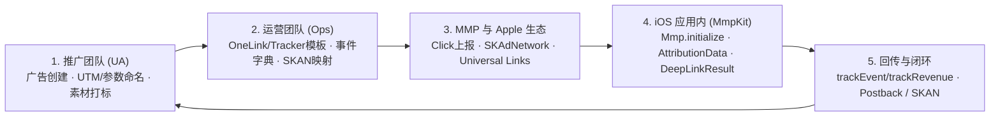

# MmpKit-iOS 全链路归因与深度链接 SOP（推广 → 运营 → SDK 识别）

本文档定义业务在使用 **MmpKit-iOS**（AppsFlyer / Adjust 统一门面）时，从**市场投放推广**、**运营与 MMP 后台配置**、**App Store 分发与 ATT/SKAN** 到**iOS 应用内 SDK 识别与业务响应**的全链路标准作业程序（SOP）。

---

## 1. 全链路角色分工与流程总览



| 阶段 | 负责团队 | 核心交付物 / 动作 | 常见卡点 |
| :--- | :--- | :--- | :--- |
| **一、推广投放** | UA / 增长 / 市场 | 按标准规范生成投放链接参数、指定 `deep_link_value` | 渠道命名不规范、大小写混用导致客户端解析异常 |
| **二、运营配置** | 运营 / 产品 | 配置 OneLink / Adjust Link 模板、SKAN 转化值表、事件字典 | 漏填 Apple App ID、Adjust 忘记下发 6 位 Event Token |
| **三、技术前置** | iOS / 服务端 | 部署 AASA (`apple-app-site-association`)、配置 Associated Domains | AASA CDN 缓存或重定向导致 Universal Links 降级跳浏览器 |
| **四、应用内识别** | iOS 客户端 | 冷启动 `Mmp.initialize`、挂载监听、接入 `onOpenURL` & `onContinueUserActivity` | ATT 弹窗时机冲突、SwiftUI 未转发 `NSUserActivity` |
| **五、联调上线** | QA / 研发 / 运营 | 离线 Mock → 白名单真机沙盒测试 → 生产关闭 `isDebug` | 生产环境忘记关闭 `isDebug` 导致 Adjust 数据进沙盒 |

---

## 2. 阶段一：推广与投放命名规范（UA / 增长）

所有付费买量渠道（Apple Search Ads、Meta、TikTok、Google Ads）及自有渠道（短信、KOL、官网二维码、邮件）均须遵循以下参数约定，以便与客户端 `AttributionData` 字段精准对齐：

1. **投放维度命名约定（推荐全小写 + 下划线，禁止空格）**
   - **媒体渠道 (`network`)**：如 `Apple Search Ads`、`Facebook Ads`、`tiktok_int`、`kol_youtube`
   - **广告活动 (`campaign`)**：格式 `<业务目标>_<地域>_<日期>`，如 `spring_sale_us_202604`
   - **广告组 (`adGroup`)**：格式 `<定向人群>_<版位>`，如 `lookalike_18_35_feed`
   - **创意素材 (`creative`)**：如 `video_01_hook_a`
   - **子渠道 / 点击标签 (`clickLabel`)**：如 `kol_alex`、`landing_btn_top`
2. **深度链接跳转参数约定**
   - `deep_link_value`：目标落地路由或页面标识（例如 `mmpkit://promo/spring_sale` 或 `vip_paywall`）
   - 透传业务参数（客户端会在 `DeepLinkResult.clickEvent` 中获取）：如 `invite_code`、`coupon_id`、`sku_id`

---

## 3. 阶段二：运营与 MMP 后台配置（Ops / 产品）

### 3.1 应用标识、AASA 与 iOS 系统关联前置配置（一次性配置）
1. **App Store Connect 绑定**：向运营与 MMP 后台提供 Bundle ID、Apple Team ID 以及纯数字的 App Store **App ID**（注意：AppsFlyer iOS 初始化必须在 `MmpConfig.appId` 中传入该 App ID）。
2. **部署 Universal Links (`apple-app-site-association`)**：
   - 确保 `https://<你的推广域名>/.well-known/apple-app-site-association` 返回 HTTP 200（无 301/302 重定向），JSON 内容声明 `applinks.details` 包含 `<TeamID>.<BundleID>`。
   - iOS 工程 `Signing & Capabilities` 开启 **Associated Domains**，添加 `applinks:<你的推广域名>`。
3. **配置兜底 URL Scheme 与隐私描述**：
   - `Info.plist` 注册 `CFBundleURLTypes`（如 `mmpkit`）。
   - `Info.plist` 配置 `NSUserTrackingUsageDescription`（若 App 请求 ATT 弹窗权限）。
4. **配置 MMP 控制台与 SKAN 4.0**：
   - **AppsFlyer**：配置 OneLink Template（启用 Universal Links + URI Scheme），并在 SKAN Conversion Studio 设置 6-bit 转化值映射（如首日注册、付费档位）。
   - **Adjust**：配置 Campaign Link / Universal Link（启用 Universal Links + Tracker Token），在 Conversion Hub 配置 SKAN 映射。

### 3.2 维护《跨端标准化事件字典》
> [!IMPORTANT]
> **MmpKit 核心差异说明**：
> - **AppsFlyer**：`MmpEvent.name` / `MmpRevenue.eventName` 为**可读字符串**（如 `af_purchase`）。
> - **Adjust**：`MmpEvent.name` / `MmpRevenue.eventName` 必须为 Adjust 后台创建的 **6 位 Event Token**（如 `abc123`）。
> 建议业务层通过统一事件映射表或远程配置屏蔽该差异。

| 业务事件 | MmpKit 调用 API | AppsFlyer 事件名 | Adjust Event Token (示例) | 必填参数 (`params`) |
| :--- | :--- | :--- | :--- | :--- |
| 完成注册 | `Mmp.trackEvent` | `af_complete_registration` | `reg001` | `method` (`apple`/`email`) |
| 付费购买 / 订阅 | `Mmp.trackRevenue` | `af_purchase` | `pur002` | `revenue` (`Double`), `currency` (`"USD"`), `order_id` |
| 新手引导完成 | `Mmp.trackEvent` | `af_tutorial_completion` | `tut003` | `success` (`true`) |

---

## 4. 阶段三：iOS 应用内 SDK 识别链路（客户端）

### 4.1 冷启动初始化与监听挂载（SwiftUI `App` / `AppDelegate`）
```swift
@main
struct MyApp: App {
    init() {
        let config = MmpConfig(
            appToken: "YOUR_DEV_KEY_OR_APP_TOKEN",
            isDebug: false,          // ⚠️ 发版必须为 false
            appId: "123456789",      // iOS App Store ID (AppsFlyer 必需)
            enableLog: false
        )

        // 1. 初始化（切换厂商只需替换 AppsFlyerClient() <-> AdjustClient()）
        Mmp.initialize(config: config, client: AppsFlyerClient())

        // 2. 挂载归因监听（带自动重放：若缓存已就绪会立即回调）
        Mmp.setAttributionListener { data in
            // data.isOrganic / data.network / data.campaign / data.adGroup / data.creative
        }

        // 3. 挂载深度链接监听（覆盖冷启动延迟深链 + 热启动直接深链）
        Mmp.setDeepLinkListener { result in
            // result.deepLinkValue / result.clickEvent / result.isDeferred
            AppRouter.shared.handleDeepLink(result)
        }
    }

    var body: some Scene {
        WindowGroup {
            ContentView()
                // 4. 转发 URI Scheme 直接唤起 (如 mmpkit://...)
                .onOpenURL { url in
                    Mmp.handleOpenUrl(url)
                }
                // 5. 转发 Universal Links 唤起 (如 https://go.example.com/...)
                .onContinueUserActivity(NSUserActivityTypeBrowsingWeb) { userActivity in
                    Mmp.continueUserActivity(userActivity)
                }
        }
    }
}
```

> **UIKit `AppDelegate` / `SceneDelegate` 接入提示**：若不使用 SwiftUI 生命周期，请在 `application(_:open:options:)` 调用 `Mmp.handleOpenUrl(url, options: options)`，并在 `application(_:continue:restorationHandler:)` / `scene(_:continue:)` 调用 `Mmp.continueUserActivity(userActivity)`。

### 4.2 ATT 弹窗与归因时机配合
- 若业务启用 **ATT (AppTrackingTransparency)** 获取 IDFA：
  - 建议在首屏引导或应用进入 `didBecomeActive` 后按产品设计请求 `ATTrackingManager.requestTrackingAuthorization`。
  - 如需等待 ATT 弹窗结果再激活归因上报，可在业务侧通过原生 `AppsFlyerLib.shared().waitForATTUserAuthorization(timeoutInterval:)` 或 `Adjust.requestAppTrackingAuthorization` 配合配置，核心业务埋点仍通过 `Mmp.trackEvent` / `Mmp.trackRevenue` 统一上报。

### 4.3 归因识别与同步热缓存消费
- 归因数据到达后，`Mmp` 会更新内存热缓存，业务代码可随时同步直读：
  ```swift
  switch Mmp.isOrganic {
  case false?:
      showCampaignPaywall(network: Mmp.network, campaign: Mmp.campaign)
  case true?:
      showDefaultPaywall()
  case nil:
      showDefaultOrWait() // 归因尚未返回
  }
  ```
- **归一化字段映射参考**：

| 归一化字段 | AppsFlyer 原始字段 | Adjust 原始字段 |
| :--- | :--- | :--- |
| `network` | `media_source` | `network` |
| `campaign` | `campaign` | `campaign` |
| `adGroup` | `adgroup` / `af_adset` | `adgroup` |
| `creative` | `af_ad` / `adgroup` | `creative` |
| `clickLabel` | `af_c_id` | `clickLabel` |
| `isOrganic` | `af_status == "Organic"` | `network` 为空或 `"Organic"` |

---

## 5. 阶段四：三阶测试验收与上线检查（QA & 发布）

### Level 1：本地离线 Mock 自测（研发与模拟器）
在无白名单真机或无网络环境下，直接利用 Adapter 内置仿真方法验证 UI 分流与路由跳转：
```swift
(client as? AppsFlyerClient)?.simulateConversionData([
    "af_status": "Non-organic",
    "media_source": "Apple Search Ads",
    "campaign": "spring_sale_ios"
])
(client as? AppsFlyerClient)?.simulateDeepLink(
    value: "mmpkit://promo/spring_sale",
    clickEvent: ["coupon": "50"],
    isDeferred: true
)
```
在 iOS 模拟器验证 Direct Deep Link URL 转发链路：
```bash
xcrun simctl openurl booted "mmpkit://promo/spring_sale?coupon=50"
```

### Level 2：MMP 沙盒白名单真机联调（提测验收）
- [ ] 测试 iPhone 的 IDFA（或 IDFV）已加入 AppsFlyer **Test Devices** 或 Adjust **Testing Console** 白名单。
- [ ] `MmpConfig.isDebug = true`、`enableLog = true`，在 Xcode Console 过滤 `MmpKit` 观察日志。
- [ ] **卸载重装验证 Deferred Deep Link**：卸载 App → Safari 点击测试 OneLink / Adjust Link → 通过 Xcode 安装包冷启动 → 确认收到 `isOrganic == false` 且 `isDeferred == true`。
- [ ] **已安装验证 Universal Links**：备忘录长按测试短链确认提示「在 App 中打开」→ 点击直接拉起并触发 `DeepLinkListener`（`isDeferred == false`）。
- [ ] **事件与收入验收**：完成注册与内购测试 → 在 MMP 控制台 Live Stream / Testing Console 核对事件与金额。

### Level 3：生产发布上线 Checklist
- [ ] Release 构建确认 `MmpConfig.isDebug = false`、`enableLog = false`。
- [ ] 使用 Apple CDN 检查工具（`https://app-site-association.cdn-apple.com/a/v1/<domain>`）确认 AASA 已被苹果 CDN 正常抓取更新。
- [ ] 上线后 48 小时核查：SKAN 回调接收情况、自然量 vs 买量归因比例、DeepLink 路由成功率。
